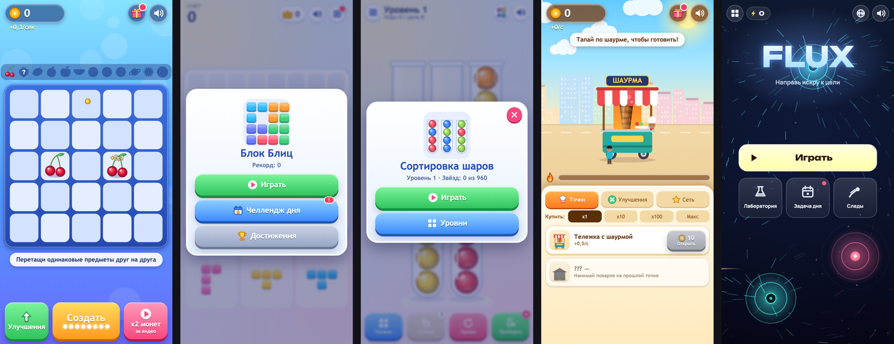

# yandex-games

Пять HTML5-игр на чистом JavaScript и Canvas, без движков, без картинок и без аудиофайлов: графика и звук генерируются кодом. Игры собирались под Яндекс Игры, а вокруг них вырос слой адаптеров, который собирает один и тот же исходник под несколько площадок.

| игра | жанр | что внутри |
|---|---|---|
| `game1-merge` Cherry to Galaxy | merge + idle | 12 уровней предметов (от вишни до галактики), авто-слияние, офлайн-доход, ежедневный бонус |
| `game2-blocks` Block Blitz | блочный пазл | три фигуры за раунд, линии, комбо, достижения, рекорд |
| `game3-sort` Ball Sort | сортировка | 320 уровней, генерируемых кодом, каждый проверен решателем |
| `game4-shawarma` Shawarma Tycoon | кликер / тайкун | экономика в `economy.js`, апгрейды, «франшиза» (престиж) |
| `game5-flux` Flux | физический пазл | 48 уровней в 8 мирах, процедурные «Лаборатория» и «Задача дня», уровни получены обратным построением |

Интерфейс на русском, английском и турецком (`?lang=ru|en|tr`).



Играть в браузере: https://bogemadumb.github.io/yandex-games/

## Играть

Статическая сборка без рекламы и SDK:

```bash
npm run serve        # собирает dist/web/ и поднимает http://localhost:8080
```

На GitHub Pages: в репозитории включить Settings → Pages → Source: GitHub Actions; workflow `.github/workflows/pages.yml` соберёт `dist/web/` и выложит его. Каждая игра будет по адресу `https://<user>.github.io/<repo>/<игра>/`, а на корне список игр. Подойдёт и любой другой статический хостинг: достаточно отдать содержимое `dist/web/`.

Что отличается в веб-сборке: вместо Яндекс SDK подключается заглушка `sdk-mock.js` (сохранение в `localStorage`, реклама пропускается, награда за «рекламное видео» выдаётся сразу).

## Стек

Vanilla JS (ES5/ES6), Canvas 2D, Web Audio API, CSS. Сборка — один скрипт на Node.js без зависимостей (`build.js`, внешний `zip` нужен только для архивов под площадки). Тесты и инструменты — Node.js и Python (Playwright).

## Архитектура и решения

```
gameN-*/            исходник игры: index.html, game.js, style.css, platform.js, sdk-mock.js
platform/           адаптеры: core.js (утилиты) + yandex.js | vk.js | gamepush.js | crazygames.js
build.js            собирает games × platforms в dist/<игра>-<площадка>.zip или dist/web/
gameN-*-tools/      решатели, симуляторы, e2e-скрипты, генераторы карточек
gameN-*-store/      тексты карточек магазина и обложки
platform-tools/     подставной GamePush SDK и smoke-тест площадок
```

- **Один интерфейс площадки.** Игра вызывает `Platform.init / ready / showInterstitial / showRewarded / saveData / loadData / getLang`, а за ним лежит один из адаптеров. В `index.html` блок `<!--sdk-->…<!--/sdk-->` подменяется сборщиком, так что игровой код про площадку ничего не знает.
- **Подставной SDK.** `sdk-mock.js` имитирует Яндекс SDK (реклама, игрок, облачное сохранение), поэтому игры запускаются локально и в автотестах без аккаунта и сети.
- **Всё нарисовано кодом.** Нет ни одного внешнего ассета, поэтому игры весят десятки килобайт и нет проблем с правами на графику и звук.
- **Уровни проверяются машиной.** Ball Sort: генератор делает уровни обратным перемешиванием, а `solver.js` (A* с весами) доказывает решаемость всех 320 уровней. Flux: уровни строятся обратно от решения, поэтому решение гарантировано, а сложность подгоняется симуляцией (`build-levels.js`). Shawarma: `sim.js` моделирует прохождение разными профилями игрока и показывает, за сколько минут открываются стадии экономики.
- **Детерминизм.** «Задача дня» во Flux: один сид на дату у всех игроков.
- **Сохранения.** Локально в `localStorage`, у игроков с авторизацией — через облачное хранилище площадки; гость не теряет прогресс.

## Тесты

```bash
npm test                                    # решатель Ball Sort (320 уровней) + симуляция экономики Shawarma
node build.js --platform vk                 # потом: python3 platform-tools/smoke.py vk <порт> <название>
python3 game3-sort-tools/e2e.py ...         # браузерные сценарии (pip install playwright && playwright install chromium)
```

Результат `npm test` в чистой копии: структура 320/320 уровней корректна, решатель проходит 320/320 (в среднем 23 хода), все 64 уровня с одной пустой пробиркой воспроизводятся по записанному решению; симуляция Shawarma печатает минуты до каждой стадии экономики.

## Сборка под площадки

```bash
node build.js                                # все игры × yandex, vk, gamepush → dist/*.zip
node build.js game3-sort --platform yandex   # одна игра, одна площадка
node build.js --platform crazygames          # адаптер написан по документации SDK v3, на реальной площадке не проверялся
```

Для GamePush ключи не хранятся в репозитории: `games.json` содержит пустые `gamepush: {}`, значения передаются переменными окружения `GP_PROJECT_ID` и `GP_PUBLIC_TOKEN`.

## Что не вошло

В репозитории нет готовых архивов (`dist/`, `*.zip`) и большей части скриншотов карточек магазина: остались `store.md`, обложка, иконка и один скриншот на игру. Тексты карточек в `store.md` ссылаются на файлы, которые не включены.

## Лицензия

Код — MIT (`LICENSE`). В `game5-flux/style.css` встроены в base64 шрифты Unbounded и Manrope (SIL OFL 1.1), тексты лицензий лежат в `licenses/`. `platform/vendor/vk-bridge.min.js` — официальная сборка `dist/browser.min.js` из npm-пакета `@vkontakte/vk-bridge@3.0.2` без изменений (MIT, V Kontakte, LLC; текст лицензии в `licenses/vk-bridge-LICENSE`).
